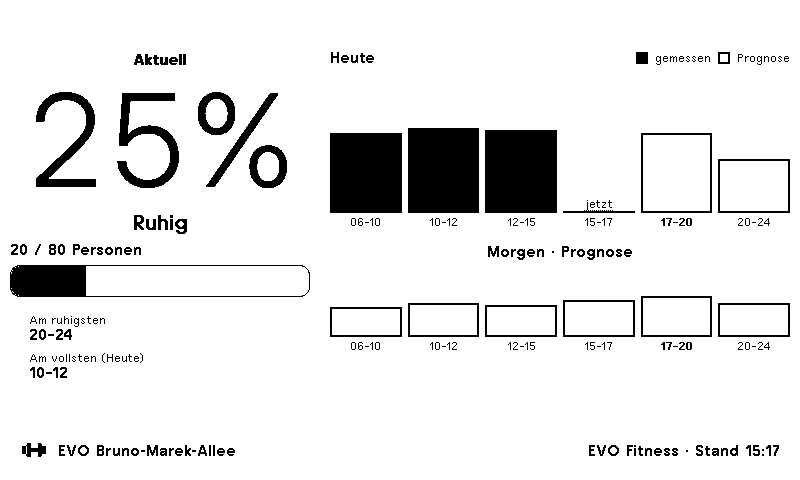

# TRMNL EVO Fitness Occupancy


A TRMNL plug-in that shows how busy your EVO Fitness gym is right now. It displays the live headcount, today's occupancy per time slot (measured values for past slots, forecast for upcoming ones), the quietest slot still ahead and tomorrow's forecast. Works for EVO gyms in Austria, Germany and Switzerland.

Unofficial plug-in, not affiliated with EVO Fitness.

## Settings

| Field | Purpose |
|---|---|
| Country | Austria, Germany or Switzerland. Decides which gym list is shown |
| Gym | Your EVO Fitness gym in the selected country |
| Language | Text on the display: German, English or French |

To show several gyms on one screen, add the plug-in once per gym and combine the instances in a TRMNL Mashup.

## Limitations

- **German gyms show live occupancy only.** EVO's time-slot data for all German gyms is currently unusable (values of several thousand percent), so the charts are hidden. The plug-in detects this per gym, and the charts appear on their own once EVO's data is sane again.
- The chart bars carry no numbers. EVO's time-slot figures run well above the live percentage for the same period (a slot reported as 58% had live readings around 20%), so the bars only show which slots are busier than others. The running slot is marked "now" without a bar.
- The data comes from an undocumented endpoint and may change without notice.

## Data source

The plug-in polls the same JSON endpoints as EVO's public occupancy pages ([visits.evofitness.at](https://visits.evofitness.at), .de, .ch) every 15 minutes:

```
/api/v1/locations/{id}/current                    live headcount and capacity
/api/v1/locations/{id}/timeline                   today's time slots
/api/v1/locations/{id}/timeline?date=YYYY-MM-DD   forecast for another day
```

The gym lists in `src/settings.yml` are fixed. When EVO opens a new gym, fetch the current list and add the entry to the matching `gym_*` field:

```sh
curl -s 'https://visits.evofitness.at/api/v1/locations?operator=051b413f-0245-4e84-9228-f3c7c5f8d299'   # Austria
curl -s 'https://visits.evofitness.de/api/v1/locations?operator=c04bc7c3-903f-4804-a952-9abc0016b824'   # Germany
curl -s 'https://visits.evofitness.ch/api/v1/locations?operator=4de2a7cb-bd28-4111-aa28-4bbcdf60f533'   # Switzerland
```

## Development

The templates live in `src/`. Requires a non-system Ruby (macOS ships Ruby 2.6, too old for `trmnlp`):

```sh
export PATH="/opt/homebrew/opt/ruby/bin:$PATH"
gem install trmnl_preview
trmnlp serve      # http://localhost:4567
trmnlp lint       # same gate as CI
trmnlp build --png
```

Custom field values for the local server are preset in `.trmnlp.yml`, which is not uploaded to TRMNL. It lists gym IDs for trying the Swiss and the German (live-only) case.

Every push to `main` runs `trmnlp lint`. Once `src/settings.yml` contains the plugin `id` (written by the first manual `trmnlp push`), the workflow also runs `trmnlp push`, which needs the `TRMNL_API_KEY` repository secret. From then on, edit the plug-in here rather than in the TRMNL web editor, otherwise changes are overwritten on the next push.

## Credits
Data provided by <a href="https://www.evofitness.at">EVO Fitness</a>
